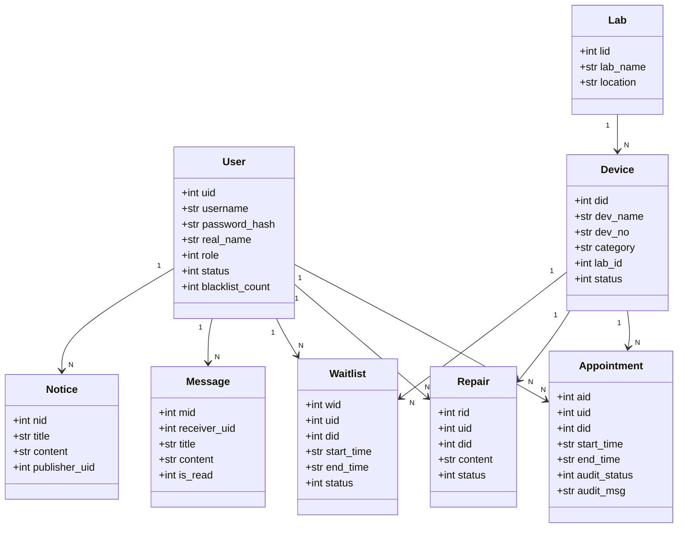
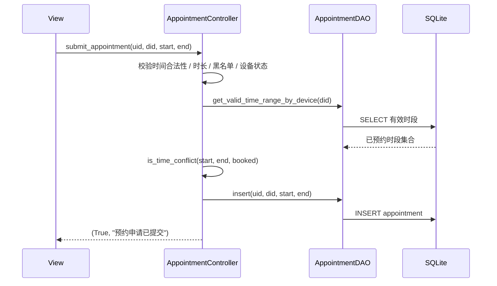
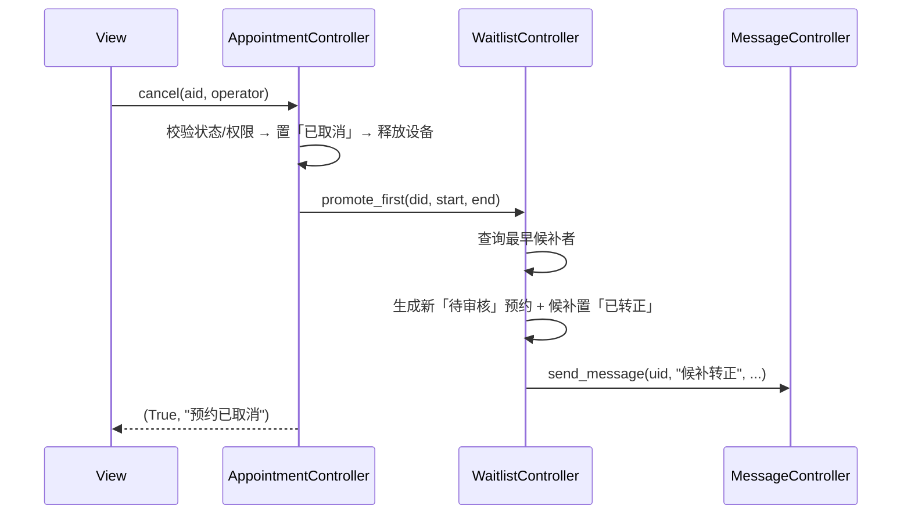
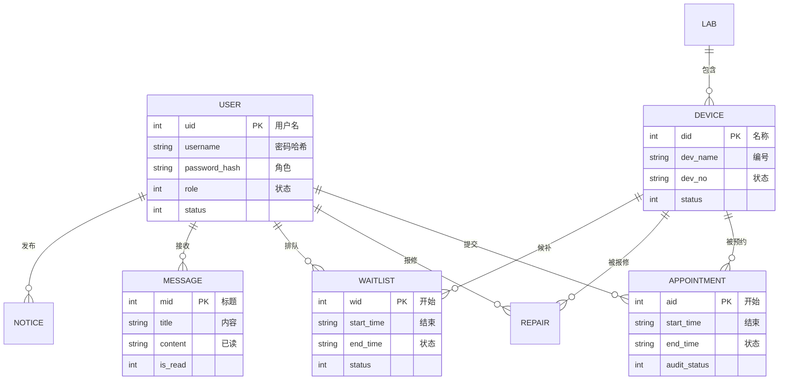

# 实验五：系统详细设计（E-R、类图、时序图）

## 1. 核心类图



**类关系说明**：

| 关系 | 说明 |
| --- | --- |
| 关联 | Appointment / Repair / Waitlist 分别关联 User 与 Device |
| 聚合 | Lab 聚合 Device（实验室包含多台设备） |
| 依赖 | Message 依赖 User（接收者） |

## 2. 关键业务时序图

### 时序 1：学生提交预约



### 时序 2：取消预约触发候补转正



## 3. E-R 图（实体-关系）



## 4. 数据库表结构概要（10 张表）

| 表名 | 主键 | 主要字段 | 外键 |
| --- | --- | --- | --- |
| user | uid | username, password_hash, real_name, role, status, phone, blacklist_count, create_time | — |
| lab | lid | lab_name, location, open_time, remark | — |
| device | did | dev_name, dev_no, category, lab_id, spec, status, image_path, remark | lab_id → lab.lid |
| appointment | aid | uid, did, start_time, end_time, apply_time, audit_status, audit_msg, cancel_time | uid, did |
| repair | rid | uid, did, content, status, deal_time, deal_msg | uid, did |
| notice | nid | title, content, publisher_uid, publish_time | publisher_uid → user.uid |
| sys_log | log_id | uid, op_content, op_time | uid → user.uid |
| waitlist | wid | uid, did, start_time, end_time, join_time, status | uid, did |
| message | mid | receiver_uid, title, content, is_read, create_time | receiver_uid → user.uid |
| setting | skey | svalue | — |

完整字段级数据字典见《实验二 需求规格说明书》5.2 节。

## 5. 状态机设计

### 5.1 预约单状态机

```
待审核(0) ──通过──▶ 已通过(1) ──标记完成──▶ 已完成(4)
   │                    └──标记爽约──▶ 爽约(5)
   ├──驳回──▶ 已驳回(2)
   └──取消──▶ 已取消(3)
已通过(1) ──取消──▶ 已取消(3)
```

### 5.2 设备状态机

```
空闲(1) ──预约通过──▶ 占用(2) ──完成/取消/爽约──▶ 空闲(1)
空闲(1) ──管理员设置──▶ 维修(3) / 报废(4)
```

### 5.3 报修状态机

```
待处理(0) ──▶ 维修中(1) ──▶ 已修复(2)
```

### 5.4 候补状态机

```
等待中(0) ──预约取消转正──▶ 已转正(1)
等待中(0) ──主动取消──▶ 已取消(2)
```

## 6. 关键算法

### 6.1 时段冲突检测（开区间）

```python
def is_time_conflict(start, end, booked):
    for b_start, b_end in booked:
        if start < b_end and b_start < end:
            return True
    return False
```

- 首尾相接（08:00-10:00 与 10:00-12:00）不冲突；
- 应用于「提交预约」与「审核通过复核」两处。

### 6.2 候补转正算法

预约取消后，按 `did + start_time + end_time` 精确匹配最早「等待中」候补记录，自动生成「待审核」预约并通知候补者。
